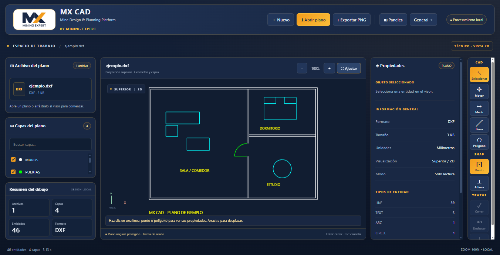

# MX CAD

Aplicación de escritorio para Windows que permite visualizar planos **DWG y DXF** de manera local, sin instalar AutoCAD ni subir los dibujos a un servidor.



## Funciones

- Abrir un archivo o arrastrarlo al visor.
- Vista 2D con zoom, desplazamiento y ajuste a pantalla.
- Vista 3D alámbrica de líneas, puntos, arcos y polilíneas compatibles, con coordenadas Z originales.
- Giro, desplazamiento, zoom y vistas isométrica, superior y frontal en 3D.
- Buscar capas y activar o desactivar su visualización.
- Exportar la vista actual a PNG.
- Plano DXF de ejemplo incluido.
- Avisos de lectura y cancelación de la apertura.

## Ejecutar

Requisitos: Windows y Node.js 22.12 o posterior, con npm.

```powershell
npm install
npm start
```

`npm start` compila el proyecto y abre la ventana de escritorio. Electron sirve los recursos exclusivamente en `127.0.0.1` con un puerto asignado por el sistema. No hay servicio de subida de planos.

Para desarrollo en navegador: `npm run dev`. Para compilar: `npm run build`.

Atajos: **Ctrl+O** abre un plano y **F** ajusta la vista. La rueda hace zoom y arrastrar desplaza el plano.

## Compatibilidad

Es un visor con vista 2D y vista 3D alámbrica, no un editor ni un sustituto completo de AutoCAD. La compatibilidad DWG depende de LibreDWG. La vista 3D utiliza la geometría que entrega el lector: un plano sin alturas Z permanece plano. No reconstruye volúmenes ni renderiza sólidos ACIS o mallas. Las entidades propietarias, otros objetos 3D, referencias externas y fuentes ausentes pueden generar una vista parcial. No se garantiza fidelidad de todas las versiones de DWG/DXF. No se modifica el archivo original. Los cambios de visibilidad de capas afectan únicamente a la vista.

## Pruebas

`npm test` inicia Electron con ventana oculta y comprueba la apertura del DXF incluido, las capas, el zoom, la exportación PNG y el tratamiento de archivos inválidos. Requiere haber ejecutado `npm run build`.

También se probó la apertura de `example_2000.dwg` de [LibreDWG](https://github.com/LibreDWG/libredwg/tree/master/test/test-data). Para incluir otro DWG en las pruebas, define `MX_CAD_DWG_FIXTURE` con su ruta antes de ejecutar `npm test`. Los archivos personales de prueba no se incluyen en el repositorio.

## Motor y licencia

Este proyecto usa [@flyfish-dev/cad-viewer](https://github.com/flyfish-dev/cad-viewer), bajo AGPL-3.0-only, y su lector DWG basado en [LibreDWG WebAssembly](https://github.com/mlightcad/libredwg-web). MX CAD se distribuye bajo **AGPL-3.0-only**. Las dependencias conservan sus licencias respectivas; ver `THIRD_PARTY_NOTICES.md`.


## Vista 3D

Abre un DXF o DWG y pulsa **3D**. Arrastra para girar, usa **Mayúsculas + arrastrar** para desplazar y la rueda o los botones +/− para acercar. El selector cambia entre isométrica, superior y frontal. Las capas controlan también la vista 3D y **Exportar PNG** guarda la vista actual. Pulsa **2D** para volver a las herramientas de dibujo. Los trazos de sesión permanecen en la vista 2D.


## Model y presentaciones

Al abrir DWG o DXF, las pestañas **Model** y los nombres de las presentaciones aparecen sobre el visor. Cada hoja agrupa sus entidades por nombre de Layout o propietario BLOCK_RECORD; no se mezclan las entidades de papel con el modelo. La vista 3D y los trazos de sesión corresponden a Model.

Las hojas representan el tamaño y las unidades recuperados del archivo, sus entidades y cajetines, y las ventanas ortográficas superiores del modelo, con escala, giro, recorte rectangular o poligonal recto y capas congeladas disponibles. Si falta el tamaño, se informa y se ajusta al contenido sin asumir A4/A3. Los patrones hatch y sus islas, colores, transparencia explícita y grosores disponibles se representan en Canvas. Los límites curvos se discretizan y las tramas demasiado densas se simplifican a resolución de pantalla.

**Cargar imágenes, fuentes o Xrefs** permite aportar PNG/JPEG/WebP/BMP, SHX, TTF/OTF y archivos DWG/DXF externos desde el equipo. Se vinculan por nombre, nunca se descargan automáticamente desde las rutas del dibujo. Se muestran los nombres de los recursos que faltan. La exportación PNG guarda la presentación y el encuadre seleccionados.

### Límites de fidelidad

No es un motor de impresión AutoCAD. No reproduce completamente CTB/STB, overrides gráficos de viewport, escalas anotativas, texto MTEXT enriquecido, bigfonts ni imágenes recortadas. Los viewports en perspectiva o inclinados y los recortes curvos no compatibles se omiten con aviso; no se sustituyen por una ventana rectangular inventada. Las splines hatch no recuperables se señalan. Las cotas usan su bloque gráfico cuando existe; si falta, no se reconstruye automáticamente todo DIMSTYLE. Los sólidos ACIS, objetos proxy y algunas referencias pueden seguir incompletos.

El control **Avisos del dibujo** distingue recursos ausentes y representaciones aproximadas o no compatibles. Para verificar fidelidad con planos de producción, compare una hoja con su PDF de referencia de AutoCAD.

### Motor local y pruebas

Se conserva una copia identificada del motor AGPL en `src/vendor/cad` para corregir la extracción y el renderizado: ver `src/vendor/cad/UPSTREAM.md`. No hay servicios externos ni dependencias de pago. Vite empaqueta el worker modificado y usa los recursos WASM del paquete fijado.

La suite añade separación de espacios, tamaños de hoja, transformación de viewports, límites hatch, apertura de un DXF con varias hojas y un DWG público real, exportación y carga de imágenes locales. Las pruebas Electron requieren la compilación y una plataforma con Electron.


## Modelos BIM gratuitos: IFC y glTF/GLB

El botón **Abrir plano** y el área de arrastre aceptan también `.ifc`, `.glb` y `.gltf`. Se visualizan como modelos 3D con giro, zoom, ajuste, selección, búsqueda de elementos, visibilidad individual, propiedades básicas y exportación PNG. Un IFC se procesa en un worker local cancelable. Para glTF con recursos externos, selecciona a la vez el `.gltf`, sus `.bin` y las imágenes; las rutas remotas no se descargan. Se recomienda GLB autocontenido. Los datos no se suben a servicios externos y no hay una licencia de visualización de pago.

**NWD, NWC y NWF no son formatos admitidos directamente.** Este visor no incluye un conversor Navisworks. Usa una herramienta que pueda convertir tu archivo, o exporta IFC/GLB desde la aplicación que creó el modelo original. La conversión puede requerir una herramienta con licencia y puede perder propiedades; comprueba su resultado antes de usarlo.

Límites: WebGL2 requerido; IFC depende de web-ifc y de las representaciones geométricas que soporte. Solo se muestran propiedades básicas de entidades, no todos los conjuntos de propiedades o relaciones BIM. GLB/glTF conserva geometría, materiales y propiedades `extras` disponibles; no convierte mallas en objetos BIM. Animaciones, Draco, Meshopt y texturas comprimidas KTX2 no se configuran en esta versión. Los modelos se centran para visualizarse; no se ofrece coordinación geográfica ni federación. Archivos muy grandes pueden superar la memoria del equipo. Los Layouts y herramientas de dibujo continúan disponibles al abrir un DWG/DXF.

Bibliotecas: Three.js 0.180.0 (MIT) y web-ifc 0.0.72 (MPL-2.0). Se sirven desde el propio sitio, incluidos sus recursos WASM y licencias, sin CDN ni servicios de pago.

## Comandos y rendimiento

La barra vertical derecha permanece disponible en Model, Layouts, CAD 3D y BIM. Incluye selección cuando es compatible, Pan con botón central, zoom, ajuste, ventana, encuadre anterior y vistas 3D. Consulta [navegación y mediciones](docs/navigation-performance.md) para conocer las optimizaciones, la metodología y las limitaciones de fidelidad pendientes.
