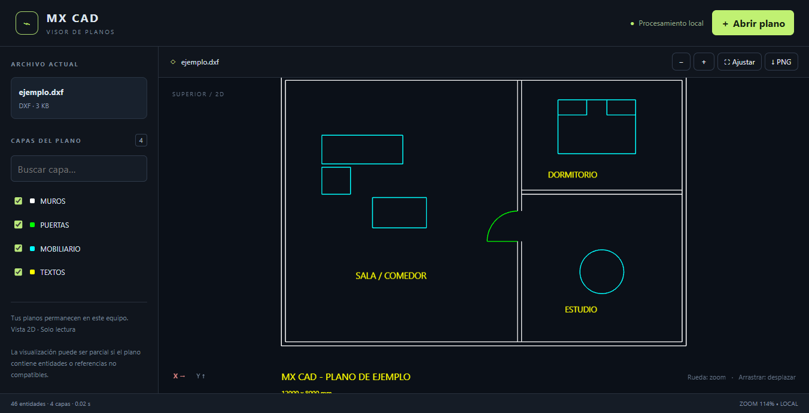

# MX CAD

Aplicación de escritorio para Windows que permite visualizar planos **DWG y DXF** de manera local, sin instalar AutoCAD ni subir los dibujos a un servidor.



## Funciones

- Abrir un archivo o arrastrarlo al visor.
- Vista 2D con zoom, desplazamiento y ajuste a pantalla.
- Buscar capas y activar o desactivar su visualización.
- Exportar la vista actual a PNG.
- Plano DXF de ejemplo incluido.
- Avisos de lectura y cancelación de la apertura.

## Ejecutar

Requisitos: Windows y Node.js 22.12 o posterior, con npm.

```powershell
npm install
npm start
```

`npm start` compila el proyecto y abre la ventana de escritorio. Electron sirve los recursos exclusivamente en `127.0.0.1` con un puerto asignado por el sistema. No hay servicio de subida de planos.

Para desarrollo en navegador: `npm run dev`. Para compilar: `npm run build`.

Atajos: **Ctrl+O** abre un plano y **F** ajusta la vista. La rueda hace zoom y arrastrar desplaza el plano.

## Compatibilidad

Es un visor de solo lectura y vista 2D, no un editor ni un sustituto completo de AutoCAD. La compatibilidad DWG depende de LibreDWG. Las entidades propietarias, objetos 3D, referencias externas y fuentes ausentes pueden generar una vista parcial. No se garantiza fidelidad de todas las versiones de DWG/DXF. No se modifica el archivo original. Los cambios de visibilidad de capas afectan únicamente a la vista.

## Pruebas

`npm test` inicia Electron con ventana oculta y comprueba la apertura del DXF incluido, las capas, el zoom, la exportación PNG y el tratamiento de archivos inválidos. Requiere haber ejecutado `npm run build`.

También se probó la apertura de `example_2000.dwg` de [LibreDWG](https://github.com/LibreDWG/libredwg/tree/master/test/test-data). Para incluir otro DWG en las pruebas, define `MX_CAD_DWG_FIXTURE` con su ruta antes de ejecutar `npm test`. Los archivos personales de prueba no se incluyen en el repositorio.

## Motor y licencia

Este proyecto usa [@flyfish-dev/cad-viewer](https://github.com/flyfish-dev/cad-viewer), bajo AGPL-3.0-only, y su lector DWG basado en [LibreDWG WebAssembly](https://github.com/mlightcad/libredwg-web). MX CAD se distribuye bajo **AGPL-3.0-only**. Las dependencias conservan sus licencias respectivas; ver `THIRD_PARTY_NOTICES.md`.
